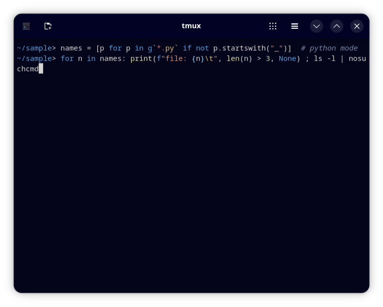

# Deepwick for xonsh

Deepwick syntax highlighting and prompt colors for [xonsh](https://xon.sh).

> Deepwick is an unofficial theme derived from
> [Polywick Blue](https://vscode.polywickstudio.net) by Polywick Studio (MIT).
> Not affiliated with Polywick Studio.



## Install

```sh
mkdir -p "${XDG_CONFIG_HOME:-$HOME/.config}/xonsh/rc.d"
cp deepwick.xsh "${XDG_CONFIG_HOME:-$HOME/.config}/xonsh/rc.d/"
```

xonsh runs every file in `rc.d` at startup. Alternatively keep the file
elsewhere and add `source /path/to/deepwick.xsh` to `~/.xonshrc`.

## Notes

- Commands and Python builtins Yellow, keywords Blue, imports Magenta, classes
  Teal, variables Light Blue, strings Orange, escapes Gold, numbers Sage,
  comments Comment *italic*, errors Red.
- xonsh's lexer gives all keywords one token, so control-flow keywords
  (`if`, `for`, `return`) are Blue rather than Magenta. Command names and
  Python builtins share one token and color.
- An unknown command at the start of a line is lexed as a Python name, so it
  is not shown in Red; after `|`, `&&` or inside `$()` it is.
- Prompt colors such as `{BLUE}` and `LS_COLORS`-based path highlighting use
  the Deepwick ANSI palette.
- The theme enables 24-bit color (`$PROMPT_TOOLKIT_COLOR_DEPTH`) when
  `COLORTERM` is `truecolor` or `24bit`. Override individual styles with
  `$XONSH_STYLE_OVERRIDES`.

Tested with xonsh 0.24.1.

## License

MIT. See [LICENSE](LICENSE).
